# WORK IN PROGRESS - DO NOT USE THIS YET

# API Gateway

A self-hosted, single-tenant gateway that keeps bot and API tokens away from your scripts.
Each script gets its own gateway key, limited to the actions you allow. The gateway holds the real credentials (encrypted), makes the upstream call and records it in an audit log.

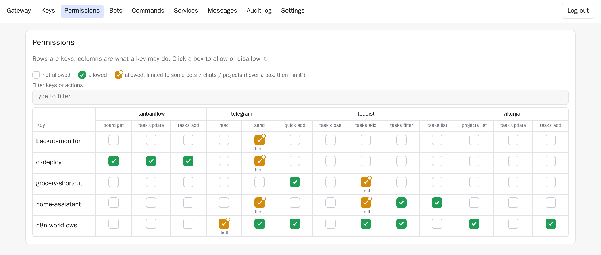

## What it does
- **Telegram:** run several bots, each with its own allowlist of who it may talk to. Send messages, and receive incoming ones by long polling; they are stored encrypted.
- **Bot commands:** `/todo buy milk` sent to a bot runs one allowed operation (e.g. Todoist quick add) as a gateway key, and the bot replies.
- **Any HTTPS API:** describe a service and its allowed operations as data, with no code. Packs for Todoist, KanbanFlow and Vikunja are included.
- **Per-key permissions:** each key gets specific actions. A grant can be limited to certain bots, chats or projects, and keys can be revoked instantly.
- **Generated clients:** for each key, a ready-to-copy Python client (standard library only) or `sh` + `curl` script, with one function per allowed action.
- **Audit log:** every call is recorded with its key, action, resource, status, latency and client IP.

## Contributing
Contributions are welcome: bug reports, feature ideas, new service packs and code.

- **Issues:** open one for bugs or ideas. For bugs, say what you expected, what happened, and how to reproduce it.
- **Pull requests:**
  1. Fork the repo and branch off `develop`:
     - `feature/<short-name>` for new features
     - `fix/<short-name>` for bug fixes
     - `docs/<short-name>` for documentation only
  2. Keep each PR focused on one change. Add or update tests where it makes sense.
  3. Run `./podman-test.sh` (or `./docker-test.sh`) and make sure it passes.
  4. Open the PR against `develop`, not `master`. Describe what changed and why.
- `master` holds releases. `develop` is merged into it when a release is ready.
- **Security issues:** please don't open a public issue. Contact the maintainer privately instead.

## How it works
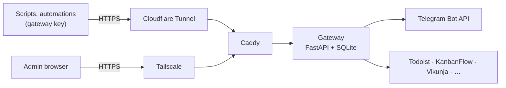
- The client API and the admin UI each have their own secret URL prefix and their own list of allowed hosts. A request with any other path or host gets an empty 404.
- **Sealed boot:** the encryption key is derived from a passphrase (scrypt) and kept only in memory. After every restart the gateway answers `503 sealed` until someone unlocks it.

## Screenshots
| | |
|---|---|
| 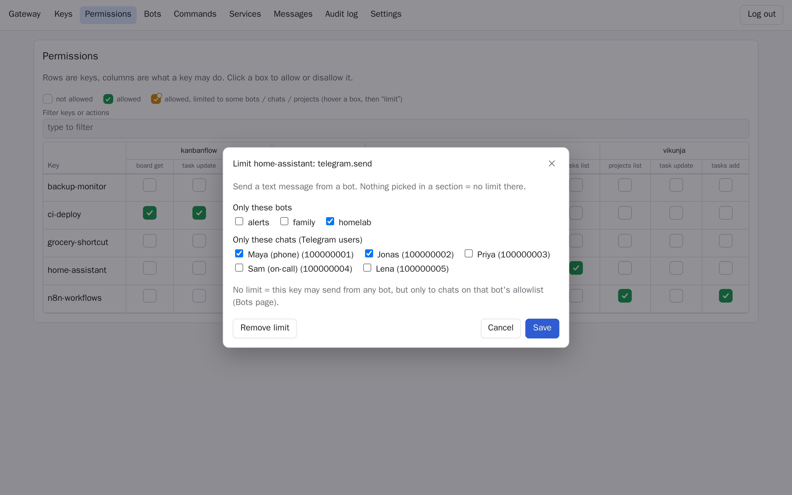 | 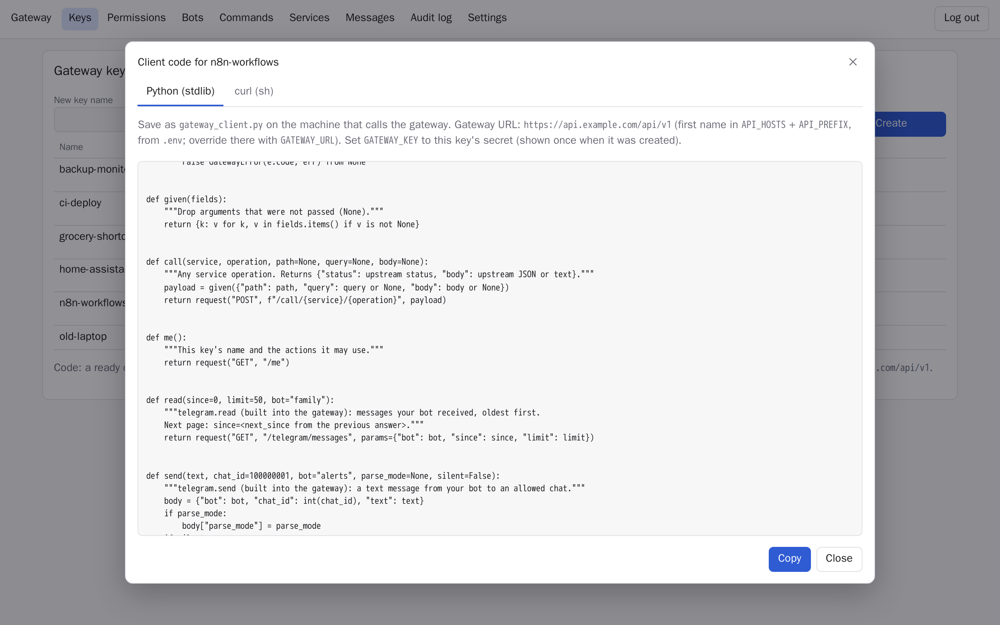 |
| **Limit a grant** to specific bots, chats or projects | **Generated client code** with one function per allowed action |
| 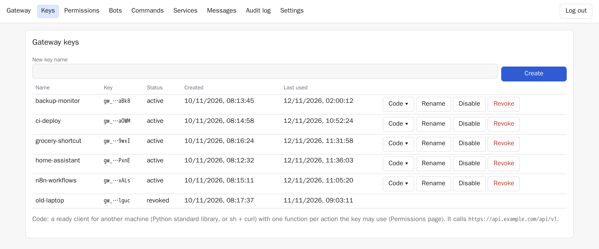 | 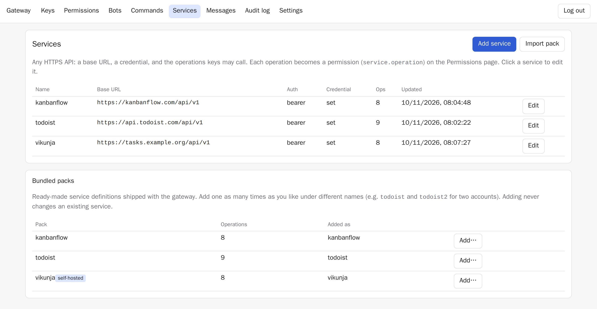 |
| **Keys:** create, rename, disable, revoke | **Services:** any HTTPS API, defined as data |
| 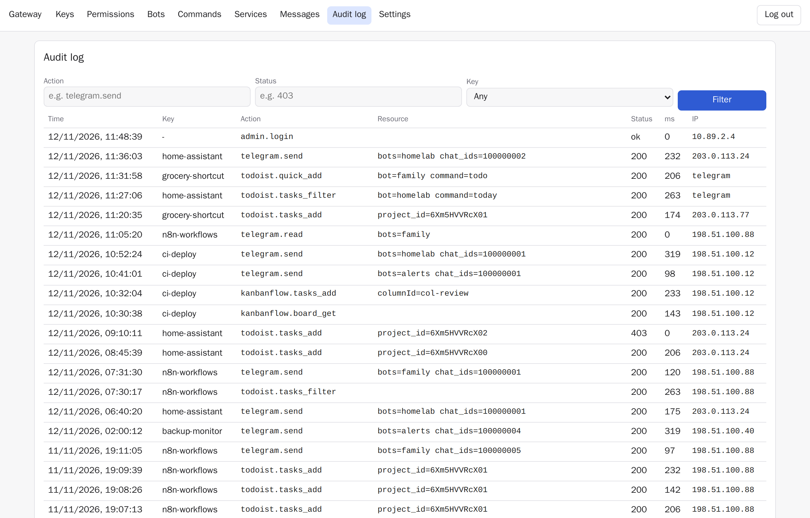 | 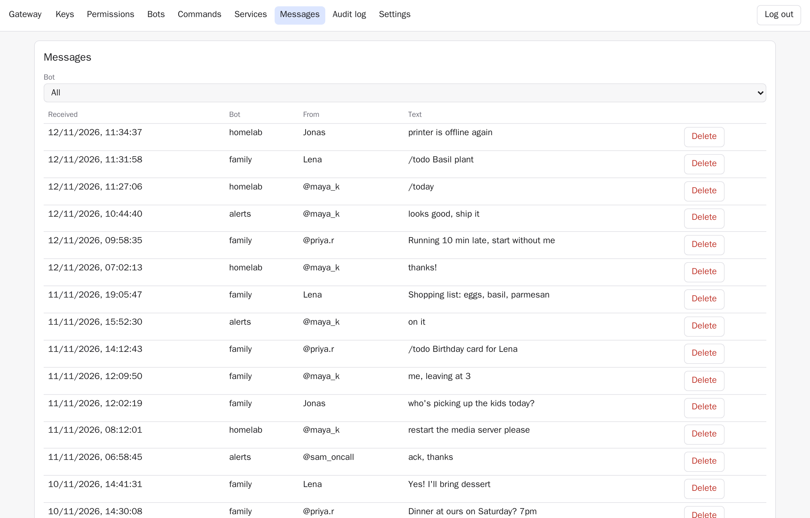 |
| **Audit log:** every call with its status, latency and IP | **Messages** received by your bots, stored encrypted |
| 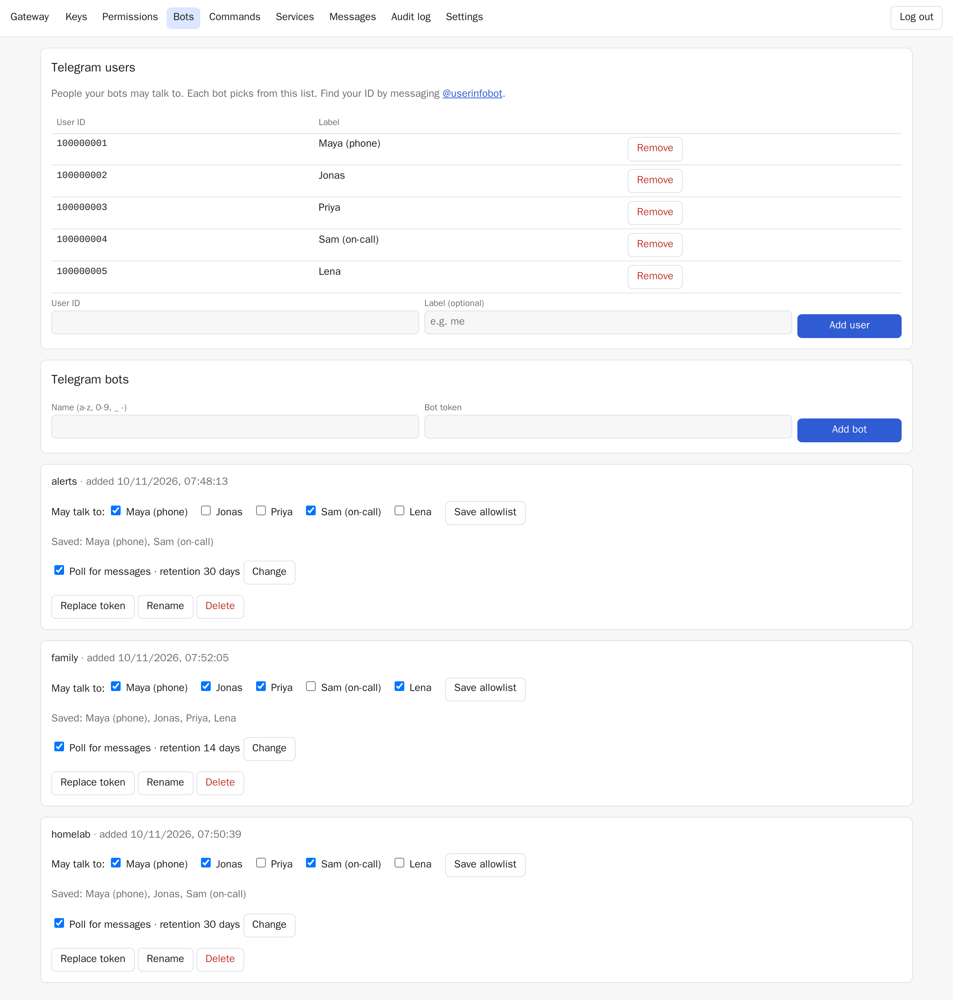 | 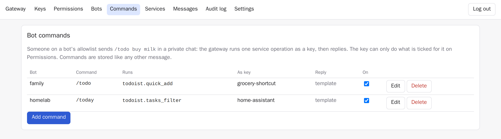 |
| **Bots:** a per-bot allowlist of Telegram users | **Bot commands:** `/todo …` runs one operation as a key, the bot replies |
| 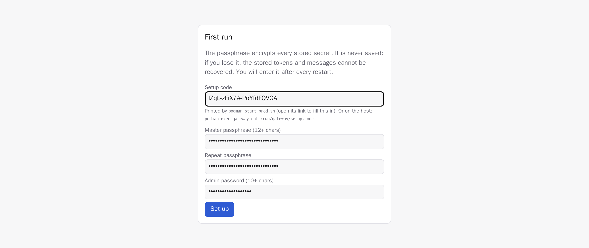 | |
| **First run:** the one-time setup code arrives prefilled from a link | |

<details><summary>Dark mode</summary>

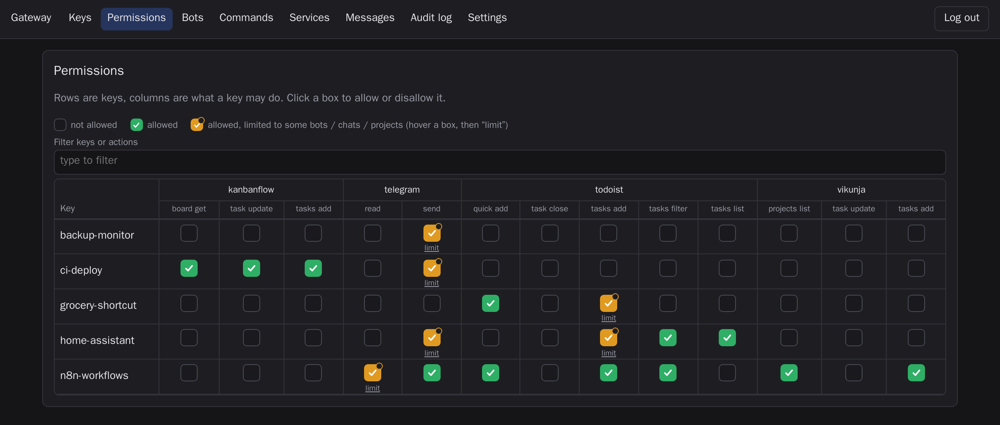
</details>

All data in the screenshots is made up. `./podman-demo-shots.sh` regenerates them from a throwaway gateway that uses fake upstream APIs.

## Security
- Bot tokens, service credentials, stored messages, chat IDs and audit details are all encrypted at rest (Fernet).
- The passphrase is never stored. Changing it re-encrypts everything in a single transaction.
- Taking over a fresh install needs a one-time setup code that only the host can read.
- Gateway keys are kept only as hashes, and each key has its own rate limit.
- Admin sessions use CSRF tokens. Failed logins and unlock attempts lock out with exponential backoff.
- Containers run read-only, as a non-root user, with every Linux capability dropped and `no-new-privileges` set.
- Image digests are pinned and Python and npm dependencies are hash-locked. Nothing is published except `127.0.0.1`.

## Quick start
```sh
./podman-start-prod.sh   # first run creates .env; set the prefixes and hosts in it, then run again
# open the printed setup link, choose a passphrase and an admin password
# add bots, services and keys in the UI
```
Full guides: [server](QUICKSTART_SERVER.md) · [client](QUICKSTART_CLIENT.md). For docker, swap `podman-` for `docker-` in any script name.

Calling the gateway from a script:
```sh
curl -s https://api.example.com/<API_PREFIX>/v1/telegram/send \
  -H "Authorization: Bearer $GATEWAY_KEY" -H "Content-Type: application/json" \
  -d '{"bot": "alerts", "chat_id": 100000001, "text": "Backup finished"}'
```

## Tech stack
Python 3 · FastAPI · SQLite (WAL, numbered migrations) · `cryptography` (Fernet, scrypt) · httpx · Svelte 5 + TypeScript · Caddy · podman / docker compose · pytest · Playwright

## Development
| Script | Does |
|---|---|
| `podman-start-dev.sh` | Dev server with hot reload: API on `127.0.0.1:38081`, UI on `127.0.0.1:38082/admin/`. Auto-unlocks; admin password `asdf`. The first start (or one after a `ui/package-lock.json` change) downloads the UI packages before 38082 answers; later starts reuse them |
| `podman-start-prod.sh` / `podman-stop-prod.sh` | Build and start / stop prod (gateway + Caddy on `127.0.0.1:38080`) |
| `unlock.sh` | Unlock the running prod gateway (no-echo prompt) |
| `podman-test.sh` | Unit and API tests, `pytest -n 4`; extra arguments go to pytest |
| `podman-smoke.sh` | Read-only checks of the scripts, pinning and the running prod stack |
| `podman-ui-check.sh` | Headless browser click-through of the admin UI |
| `podman-demo-shots.sh` | Regenerate the README screenshots from demo data |

- Every test gets its own SQLite file, its own app instance and a fake clock.
- Upstream APIs are faked with `httpx.MockTransport`, so tests need no network.
- `-m live` runs the optional tests against real Telegram and Todoist accounts.
- The dev and prod stacks use separate volumes and can run side by side.

## Layout
| Path | What |
|---|---|
| `app/` | FastAPI app: routing guard, sealing, admin auth, keys and permissions, `services/` (Telegram, polling, bot commands, generic HTTPS) |
| `app/migrations/` | Numbered SQL migrations, applied at startup |
| `ui/` | Svelte 5 admin UI, built into the prod image (no Node at runtime) |
| `packs/` | Bundled service definitions (JSON) |
| `tests/`, `smoke/`, `ui-check/`, `demo/` | pytest suites, browser check, screenshot demo |

Design and behaviour are specified in [SPEC.md](SPEC.md).
